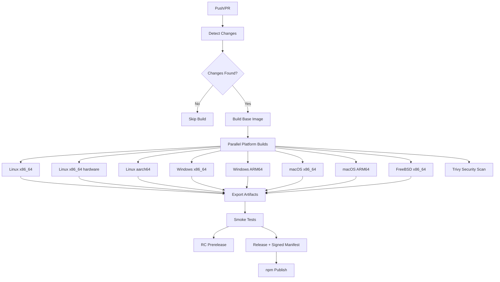

# NoMercy FFmpeg Builder

<div align="center">

[](https://github.com/NoMercy-Entertainment/nomercy-ffmpeg/actions/workflows/main.yml)
[](https://www.npmjs.com/package/@nomercy-entertainment/ffmpeg-static)
[](https://opensource.org/licenses/MIT)

**Internal Build Tool for NoMercy MediaServer**

*High-performance, cross-platform FFmpeg binaries optimized for media processing*

</div>

## 🎯 Purpose

This repository contains the build infrastructure for creating optimized FFmpeg binaries (currently **FFmpeg 9.0**) specifically tailored for the **NoMercy MediaServer** ecosystem. These builds include custom filters, muxers, codecs, and optimizations that enhance media processing capabilities within our platform.

> **⚠️ Internal Use Only**
> These FFmpeg builds are specifically configured for NoMercy MediaServer and may not be suitable for general-purpose use. For standard FFmpeg binaries, please visit the [official FFmpeg website](https://ffmpeg.org/).

## 🏗️ Architecture

Our build system uses a modular Docker-based approach: a shared base image ([ffmpeg-base.dockerfile](ffmpeg-base.dockerfile)) provides the toolchains, and per-platform dockerfiles run the numbered build steps in [scripts/](scripts/) — one script per dependency or custom patch — before compiling FFmpeg itself.

### Supported Platforms
| Platform | Architectures | Built in CI |
|----------|--------------|-------------|
| **Linux** | x86_64 (glibc 2.35 or newer: Ubuntu 22.04, Debian 12 and newer), aarch64 (ARM64) | ✅ |
| **Windows** | x86_64 | ✅ |
| **macOS** | x86_64, Apple Silicon (ARM64) | ✅ |
| **FreeBSD** | x86_64 | ✅ |
| **Windows** | ARM64 (aarch64) | ✅ ⚠️ see below |

Each release ships `ffmpeg`, `ffprobe`, and `ffplay` (where built), with the
codec libraries built in. No separate codec `.so`, `.dll` or `.dylib` files
need to be shipped. Linux x86_64 is one build: it uses the host's glibc 2.35
or newer, the way the other platforms use their system runtime, with codec,
C++ and OpenMP libraries still static, and it carries every hardware path.
Hardware acceleration is detected at run time and is simply not used on a
machine that has none. Linux ARM64 is one fully static build
that keeps its hardware paths and Vulkan. Windows uses Windows system DLLs, and macOS uses Apple's system libraries and
frameworks. FreeBSD links its base system runtime dynamically to support
Vulkan driver loading, while keeping codec libraries static. Its supported
baseline is FreeBSD 14.3.

### Linux x86_64 requirements

| Artifact suffix | Use | Runtime requirements |
| --- | --- | --- |
| `linux-x86_64` | CPU processing, and hardware acceleration on supported GPUs | glibc **2.35 or newer** (Ubuntu 22.04, Debian 12 and everything newer) and the installed system runtime; for GPU work the appropriate GPU drivers/loaders |

For FFmpeg 9.0 the archive is named `ffmpeg-9.0-linux-x86_64.tar.gz`. It
contains the codec libraries in the executables and ships no `.so` files.
There is one archive and nothing to select: on a machine with a supported GPU
and its driver the hardware paths are used, and on a machine without one the
same binary runs on the CPU.

**Minimum system.** Releases up to v1.0.45 were fully static and started on
any Linux. From v1.0.46 the binary needs glibc 2.35 or newer; on an older
system the loader refuses it before FFmpeg starts
(`version 'GLIBC_2.35' not found`). The supported systems are the long-term
support releases at that level or newer.

The floor is 2.35 because the archive is compiled and linked against
a glibc 2.35 sysroot taken from Ubuntu 22.04, not against the Ubuntu 24.04 base
image's own 2.39 (`ffmpeg-linux-x86_64.dockerfile`, stage `glibc235-sysroot`,
and `scripts/includes/glibc235_sysroot_setup.sh`). Only glibc comes from that
sysroot; everything else is built from source as before. The build refuses any
import above GLIBC_2.35 in the final executables. Design and measurements:
[docs/superpowers/specs/2026-11-04-linux-hardware-glibc235-design.md](docs/superpowers/specs/2026-11-04-linux-hardware-glibc235-design.md).

The archive passes packaging, ELF and smoke checks, and real
whisper/stemsplit CPU inference across glibc 2.35 (Ubuntu
22.04), 2.36 (Debian 12), 2.39 (Ubuntu 24.04 with Mesa's Vulkan drivers) and
2.43 (Ubuntu 26.04) hosts: `tests/lib/glibc-hosts.sh`, run by CI. It
passes H.264/HEVC NVENC, CUDA decode and real whisper
Vulkan inference on an RTX 3070 under Linux/WSL2, with static OpenMP and no
supplied shared libraries. FFmpeg's tested Vulkan
upload/scale/download video path fails cleanly through WSL's Dozen; that
limitation is separate from the successful ggml Vulkan compute workload.
See the [Linux runtime design](docs/superpowers/specs/2026-11-04-linux-gpu-runtime-design.md)
and [verification record](docs/superpowers/plans/2026-11-04-linux-gpu-runtime.md).

### Windows on ARM (windows-aarch64)

Built and released like every other platform, with one difference that matters:
**the build pipeline never executes it.** Only the release gate does, on a
hosted ARM64 runner (below).

It uses a different toolchain from the rest — llvm-mingw (clang/lld) rather than
GCC, because the GCC cross-compiler for this target crashes on
`-fstack-protector-strong` and ships a CRT header that does not parse.

Nothing in the build pipeline can run an ARM64 Windows binary. `windows-latest`
is x64, and Windows-on-ARM emulates x64 rather than the reverse, so `tests/smoke.ps1`
downgrades to validating the PE header (`Machine == 0xAA64`) instead of
executing — the same treatment `smoke.sh` gives `linux-aarch64` and
`freebsd-x86_64`. That proves the artifact is a well-formed ARM64 binary
carrying the expected symbols. It does not prove it decodes a single frame.

The release gate for it runs on GitHub's hosted `windows-11-arm` runner: real
ARM64 silicon, 4 CPU / 16 GB on a public repository, free and outside the
included minutes. `verify-rc.yml` has a matrix entry for it, `tests/tests.ps1`
runs there unchanged, and `sync-checklist.js` ticks the windows-aarch64 box
from that verdict like every other platform. The runner has no GPU, which
matches the platform: no GPU encoder exists in the windows-aarch64 build.

Before that, no Windows-on-ARM machine was in the verify fleet, so the box
stayed unticked until a human ran `tests/tests.ps1` on real hardware. An
emulated runner (an ARM64 Windows guest under QEMU on x86) was tried in
October 2026 and was the first machine ever to execute a windows-aarch64
`ffmpeg.exe`. It was also far too slow to be a gate: libx264 took 80x its
native time and libx265 was still running after 18 hours. That runner is
gone; its workflows are kept but disabled.

When running it by hand, pass the platform explicitly:

```powershell
.\tests\tests.ps1 -Workspace <extracted-dir> -Platform windows-aarch64
```

`-Platform` defaults to `windows-x86_64`, so omitting it produces a verdict
labelled for the wrong platform — which `sync-checklist.js` will then match
against the wrong checklist box.

The hosted runner is not an org self-hosted runner, so it is deliberately
absent from the `REQUIRED` list in `.github/workflows/fleet-health.yml`: that
check reads the org runner registry, and a hosted label would never appear
there.

Meanwhile Windows-on-ARM users are not stranded: the `windows-x86_64` build runs
under Windows' x64 emulation. The native build is a performance improvement.

Capability differences from `windows-x86_64`, all deliberate:

| Component | windows-x86_64 | windows-aarch64 | Why |
|---|---|---|---|
| NVENC / CUDA / AMF / QSV | ✅ | ➖ | No NVIDIA, AMD or Intel GPU exists on Windows-on-ARM |
| OpenBLAS (whisper) | ➖ | ➖ | No longer built on either. It only ever helped because ggml had no SIMD; the per-CPU ggml variants below replaced that, and OpenBLAS committed 487 MiB per ffmpeg process before `main()` (#70) |
| SVT-AV1 dotprod/i8mm | n/a | ➖ | Optional aarch64 extension kernels; baseline NEON is on. Enabling them would raise the hardware floor for every WoA device |
| Everything else | ✅ | ✅ | x264, x265, AV1, VPx, opus, xavs2, zimg, Vulkan, and all NoMercy filters/muxers |

### Build Features
- 🔒 **Security Scanning**: Trivy vulnerability assessment on all platform images
- 🧪 **Automated Testing**: Per-platform smoke tests; cross-arch artifacts are validated via ELF header inspection. On every platform the runner can execute, the smoke job also runs the stemsplit release gates: the filter's own test suite with its tiny RoFormer models, 20/20 clean exits, and Spleeter stems byte-identical with the previous release (`tests/lib/stemsplit.sh`; assets via `tests/lib/stemsplit-assets.sh`). The Linux x86_64 archive must satisfy its glibc 2.35 minimum and its explicit system-library allowlist, and must start and do real CPU inference on glibc 2.35, 2.36, 2.39 and 2.43 hosts.
- 📦 **Artifact Management**: Version-stamped archives with SHA-256 sidecars and a GPG-signed `manifest.json`
- 🔄 **Change Detection**: Decides whether a commit needs a build at all. When anything needs building, every platform is rebuilt, so a release always carries all of them; a narrowed release once handed the npm client a 404 on every platform it left out
- 🚦 **RC Pipeline**: Every master build publishes a Release Candidate prerelease before promotion to a final release

## 🚀 CI/CD Pipeline

Our GitHub Actions workflows provide a complete automation pipeline ([main.yml](.github/workflows/main.yml)):



### Workflow Components
- **Change Detection** ([detect-changes.yml](.github/workflows/detect-changes.yml)): Single source of truth for the platform list; decides whether a build is needed and then builds every platform, never a subset
- **Reusable Docker Builds** ([reusable-docker-build.yml](.github/workflows/reusable-docker-build.yml)): Parallel compilation on self-hosted runners
- **Smoke Testing**: Binaries are executed on matching GitHub-hosted runners; non-native architectures get archive and ELF-header validation
- **Security Scanning**: Trivy scans with SARIF upload to GitHub code scanning (master builds and the dev→master release PR, so the RC is scanned before the release)
- **Release Management**: RC prereleases on every master build, promoted to versioned final releases with per-asset `.sha256` sidecars, `manifest.json`, and a detached GPG signature (`manifest.json.sig`)
- **PR Guards** ([pr-guards.yml](.github/workflows/pr-guards.yml)): Gate checks on pull requests
- **npm Publish** ([npm-publish.yml](.github/workflows/npm-publish.yml)): Publishes the [`@nomercy-entertainment/ffmpeg-static`](https://www.npmjs.com/package/@nomercy-entertainment/ffmpeg-static) client when a release is created

## 🛠️ Development

### Prerequisites
- Docker with multi-platform support (and Docker Compose)
- GitHub CLI (for release management)
- PowerShell or Bash (depending on platform)

### Local Development
```bash
# Clone the repository
git clone https://github.com/NoMercy-Entertainment/nomercy-ffmpeg.git
cd nomercy-ffmpeg

# Build the shared base image first, then a platform
docker compose build ffmpeg-base
docker compose build ffmpeg-linux-x86_64

# Run a platform build — the packaged archive lands in ./output
docker compose up ffmpeg-linux-x86_64
```

### Testing
```powershell
# Windows
.\tests\tests.ps1
```
```bash
# Linux/macOS
./tests/tests.sh

# Smoke-test a packaged artifact
./tests/smoke.sh

# Unit tests for the C headers in scripts/includes (no FFmpeg build needed)
./tests/unit/run.sh
```

The `whisper` option tests need `ggml-base.en.bin` and whisper.cpp's
`jfk.wav`: set `WHISPER_TEST_MODEL` and `WHISPER_TEST_AUDIO`, or put both next
to the binary. The default-output check also needs a v1.0.44 build in
`WHISPER_TEST_REFERENCE_FFMPEG`. Without them those tests skip with a reason.

The `lyricsalign` tests need the phoneme model, `jfk.wav` and the JFK fixture:
`tests/lib/lyricsalign-assets.sh <dir>` fetches them by digest and prints the
`LYRICSALIGN_ASSETS_DIR=<dir>` line to export (or put a `lyricsalign-assets/`
directory next to the binary). Without them every `lyricsalign_*` check skips
with a reason; `LYRICSALIGN_TEST_GPU=1` adds the `use_gpu=1` check on a GPU
machine. On Windows the same checks run through Git Bash
(`tests/lib/lyricsalign.ps1`). `tools/lyricsalign-lab/` builds a minimal
ffmpeg with the filter in minutes for working on it.

The JPEG XL and HAP/APV alpha tests generate their input with `lavfi`, so they
need no assets and never skip: on a binary without one of those encoders they
fail. `tests/smoke.test.sh` runs the smoke harness against stub binaries and
proves each of those checks fails on a missing codec, a decode error and a
missing, flat, truncated or malformed alpha result.

See [CONTRIBUTING.md](CONTRIBUTING.md) for contribution guidelines and [UPDATE.md](UPDATE.md) for the dependency update process.

## 📋 Configuration & Features

### ✨ **Enhanced Features vs Official FFmpeg**

Our custom FFmpeg builds include several features **NOT** available in official FFmpeg releases:

#### 🎯 **NoMercy-Exclusive Components** (patched into the FFmpeg source tree)
| Component | Type | What it does |
|-----------|------|--------------|
| **`keydetect`** | Audio filter | Musical key and chord detection |
| **`beatdetect`** | Audio filter | Tempo, beat grid and confidence as `lavfi.beatdetect.*` frame metadata; octave decided from the onsets, not from a preferred range |
| **`stemsplit`** | Audio filter | Music source separation into vocal and accompaniment stems on ggml: Spleeter 2stems, and since v1.0.45 (stemsplit 1.1.0) Mel-Band RoFormer and BS-RoFormer ensembles with StemForge's presets; since stemsplit 1.2.1 the RoFormer models run on a Vulkan GPU with `use_gpu=auto` |
| **`trailingsilence`** | Audio filter | Reports where a stream's audible content ends as `lavfi.trailingsilence.*` frame metadata (and an optional JSON report); never cuts anything itself |
| **`lyricsalign`** | Audio filter | Time-synced lyrics by CTC forced alignment: known lyric text placed on a vocal stem with a wav2vec2 phoneme model on ggml and espeak-ng phonemes; writes JSON Lines, skips a line it is not sure of, never invents a time (#126) |
| **OCR subtitle encoder** | Codec | Converts bitmap subtitles (DVD/Blu-ray) to WebVTT text using Tesseract OCR |
| **Sprite-sheet muxer** | Muxer | Generates thumbnail sprite sheets with a WebVTT timeline for player scrubbing |
| **Chapter VTT muxer** | Muxer | Exports chapter metadata as WebVTT |
| **VOBsub muxer** | Muxer | Writes DVD-style VOBsub subtitle output |
| **OmniDrive protocol** | Protocol | Direct I/O against NoMercy OmniDrive storage (Linux/Windows/FreeBSD) |
| **`dvdread:` protocol** | Protocol | `dvdread://` URI input (byte-stream over libdvdread title VOBs, symmetric with `bluray://`) |
| **Auto-create directories** | Core patch | Output muxers automatically create missing parent directories |
| **HEVC alpha layer** | Decoder patch | Decodes the alpha channel of HEVC-with-alpha video from Apple VideoToolbox (single `hvc1` track, two-layer bitstream) instead of silently dropping it. On 8.1.x this backported upstream `eedf8f0165fe` + `3befae81f1dc`; FFmpeg 9.0 ships both, so there the script detects them and skips. What remains NoMercy's is the change that makes `ffprobe` report `yuva420p` at stream level and not just per frame ([ticket #7965](https://trac.ffmpeg.org/ticket/7965)) |
| **`whisper` language detection** | Filter patch | The `whisper` filter exposes the auto-detected spoken language (`lavfi.whisper.language` + `lavfi.whisper.language_confidence` frame metadata, `detected_language` object in JSON output) |
| **`whisper` word timestamps, prompt, beam search** | Filter patch | Per-word times in JSON output (DTW or token timing), an initial prompt (inline or from a file) and beam search; see the `whisper` section below |
| **AACS/BD+ static keydb** | Patch | libaacs/libbluray patched for built-in Blu-ray decryption support |

#### 🎤 **`stemsplit` — Music Source Separation**

Separates a music track into `vocals` and `accompaniment` stems, run on
**ggml** — the same runtime already statically linked into every platform
binary for the `whisper` filter, so `stemsplit` adds no new dependency and no
growth of the shipped tarball. Two model families are supported:

- **Spleeter** (Deezer's `2stems` U-Net): one 39 MB file, fast, modest
  quality. Every option and number in the rest of this section is Spleeter's.
- **RoFormer** (Mel-Band RoFormer and BS-RoFormer, since v1.0.45 /
  stemsplit 1.1.0): four files, 3.4 GB together, far better stems, far
  slower. See [`stemsplit` 1.1.0 — RoFormer ensembles](#-stemsplit-110--roformer-ensembles)
  below.

`ffmpeg -h filter=stemsplit` prints the architectures, presets and model
file names a given binary supports; v1.0.45 reports
`spleeter-unet-v1, mel-band-roformer-v1, bs-roformer-v1`.

```bash
# Karaoke: instrumental only, plain -af (Spleeter)
ffmpeg -i song.flac -af "stemsplit=model=2stems.gguf:stem=accompaniment" karaoke.flac

# Both stems, one filtergraph with two outputs (Spleeter)
ffmpeg -i song.flac -filter_complex \
  "[0:a]stemsplit=model=2stems.gguf:stem=all[v][a]" \
  -map "[v]" vocals.flac -map "[a]" music.flac

# Both stems, StemForge's best recipe, run in the folder holding the four RoFormer files
ffmpeg -i song.flac -filter_complex "[0:a]stemsplit=preset=full[voc][acc]" \
  -map "[voc]" vocals.flac -map "[acc]" instrumental.flac
```

`stemsplit` emits one 1024-sample frame per STFT hop, so its output is
encoder-friendly everywhere — including formats with a block-size ceiling,
such as FLAC's 65,535 samples. No rechunking filter is needed.

| Option | Type | Default | Description |
|---|---|---|---|
| `model` | string | *required* | Path to the `.gguf` model file |
| `stem` | enum | `all` | `vocals`, `accompaniment`, or `all` (one output pad per stem) |
| `highband` | enum | `extend` | How to handle the band above 11 025 Hz, which the network does not see. `extend` carries each stem's own mask at the top of the modelled band upward, crossfaded in; `passthrough` routes the untouched high band into the last stem; `zeros` reproduces upstream Spleeter bit-for-bit; `average` tiles each frame's mean mask across the band |
| `exponent` | float | `2` | Separation exponent. 2 is the released Spleeter configuration; lower is a softer split, higher a harder one |
| `bleed` | float | `0` | Smallest share of the mixture every stem keeps in any bin. Fills the deepest spectral holes; it is **not** a cure for ducking |
| `smooth` | int | `0` | Smooth the masks over this many frequency bins either side |
| `overlap` | duration | `0` | Crossfade between segments (e.g. `5`, `1.5`, `00:00:05.000`); `0` matches reference Spleeter's un-overlapped chunking |
| `threads` | int | `0` | ggml CPU threads, for both architectures. `0` uses **half** the physical cores the process may run on, at least 1 (until 1.1.0 it was every physical core; the filter must never take the whole machine), capped by `-filter_threads` when that is set lower. The count is logged once as `stemsplit: <N> ggml threads.` and never changes the output. Hyperthreads and oversubscription slow it down a lot: on an 8-core/16-thread i7-10700K the v1.0.45 Windows build separates 30 s of audio in 3.3 s at `threads=8`, 4.1 s at the default and 15.7 s at `threads=16` |

**Why `extend` is the default.** `passthrough` was, until it was measured. It
loses nothing, but it hands *all* the unmodelled energy to one stem
unconditionally — and just under the edge the vocal network has usually claimed
nearly everything, so the accompaniment's spectrum steps *up* as it crosses
11 025 Hz. On a piano-and-voice ballad that step measures **+14.0 dB**; a bright
band with nothing underneath it, over a body that ducks whenever the singer
sings, is what gets reported as a whistle and a fader. Under `extend` the same
measurement is **−0.4 dB**.

The vocal stem gains more than the accompaniment does: under every other mode
it is hard-cut at 11 kHz, so its sibilance and breath are simply absent.
`extend` puts about **38 dB** of 11–14 kHz and **51 dB** of 14–18 kHz back into
it, while changing nothing inside the modelled band.

**Any rate, any channel count, in and out.** The network is a 44.1 kHz stereo
model, so anything else is converted to that on the way in and back to the
input's own rate and layout on the way out — a 24-bit 96 kHz file produces
24-bit 96 kHz stems. 44.1 kHz two-channel audio takes neither conversion and
runs the path unchanged. Two consequences worth knowing: a hi-res file keeps
its rate but not its top octave, because the separation happened at 44.1 kHz;
and more than two channels is folded to stereo for the network and upmixed
back, which the filter logs as a warning.

**Model:** `spleeter-2stems-f16.gguf` (39,319,552 bytes, sha256
`155dc9d2e2eef70ad633af98134df29a5273defaeb98ef013d46251faa69d0ad`) is
downloaded the same way whisper's ggml models are, not bundled in the
platform tarballs. It is published as a release asset on the org's
[nomercy-stemsplit-models](https://github.com/NoMercy-Entertainment/nomercy-stemsplit-models/releases/tag/v2026.10.31)
repository, which is public, so no token is needed. The v2026.10.31 release
(every model, built from stemsplit 1.1.0) republishes it byte for byte, same
SHA-256, next to the four RoFormer files:

```
https://github.com/NoMercy-Entertainment/nomercy-stemsplit-models/releases/download/v2026.10.31/spleeter-2stems-f16.gguf
```

Earlier revisions of this section said the asset lived on *this*
repository and had not been attached to a release yet. Both were wrong,
and the CI gate that verifies Metal trusted it: it refused to fetch the
model and demanded it be copied onto the runner by hand, which nobody
did, so that job failed on every run from 2026-09-09 onward.

**This is an offline filter, by design.** The network needs a full ~512-frame
(~11.9 s) segment before it can emit anything, so `stemsplit` is unsuitable
for live playback — that lookahead is what the architecture requires, not an
oversight. Throughput for the `2stems` pair is about **7 to 9x realtime** on
an 8-core desktop CPU (i7-10700K, v1.0.45 Windows build: 30 s of audio in
4.1 s at the default thread count and 3.3 s at `threads=8`, including model
load), so a four-minute track separates in well under a minute. Earlier
revisions quoted 1.8x realtime on 16 threads; that predates the per-CPU
ggml variants below and the half-the-cores thread default, and 16 threads on
that CPU is now the slow case (see `threads`). Peak resident memory is about **194 MiB** for `stem=all`, rising
somewhat with `overlap` set non-zero. This makes it a good fit for a
media server pre-generating karaoke tracks on library scan, not for
real-time use.

**What's verified and what isn't.** The network's output is checked
layer-by-layer against a Python reference (26 of 26 layers across both
instrument networks, `rtol=1e-3`) — that is what establishes the ggml graph
faithfully reproduces Spleeter's published weights. Separately, summing the
two output stems reconstructs the original mixture to about -138 dB, but
that figure validates only the STFT/overlap-add signal path: the ratio masks
sum to 1 by construction, so the same result holds even if the network's
output were garbage — a deliberate mask-swap mutation still measured
-138.2 dB. **No human has listened to the separated output yet**; treat
separation quality as unverified until that listening pass happens.

**Licensing.** Spleeter's code and released model checkpoints are
MIT-licensed. If you use this filter or its model in published work, please
cite:

> Hennequin, Khlif, Voituret, Moussallam (2020). Spleeter: a fast and
> efficient music source separation tool with pre-trained models. *Journal
> of Open Source Software*, 5(50), 2154,
> [doi:10.21105/joss.02154](https://doi.org/10.21105/joss.02154).

As with any source-separation tool, **you must hold the rights to any
copyrighted material you process** — this carries forward Spleeter's own
upstream advisory.

#### 🎤 **`stemsplit` 1.1.0 — RoFormer ensembles**

Since v1.0.45 the binaries ship stemsplit's RoFormer support (1.1.0 then,
1.2.1 now), which adds two transformer architectures next to Spleeter:
**Mel-Band RoFormer** and **BS-RoFormer**,
with exactly the four models StemForge's "Full" presets use. Same filter,
same two stems, same output pads; every Spleeter command line keeps working
unchanged. The full reference, including how every number below was
measured, is the README of the
[ffmpeg-stemsplit](https://forgejo.phillippepelzer.me/FiLL/ffmpeg-stemsplit)
repository the filter is fetched from at build time.

**Which one?**

| | Spleeter | RoFormer, `preset=full` |
|---|---|---|
| vocals, median SDR on ten held-out tracks | 7.70 dB | 13.37 dB |
| instrumental, median SDR on the same tracks | 11.72 dB | 17.14 dB |
| model files | one, 39 MB | four, 639 MB to 913 MB each, 3.38 GB together |
| memory | about 194 MiB | the filter asks for 4.63 GB and refuses to run on a machine with less than twice that |
| speed | 30 s of audio in 3.3 to 4.1 s on an 8-core desktop CPU (7 to 9x realtime, v1.0.45) | one minute of audio in 41 to 43 minutes at 8 threads on a shared Xeon E5-2680 v4 (a lower bound) |
| GPU | opt-in (`use_gpu=1`) | opt-in (`use_gpu=auto`) since stemsplit 1.2.1: a real Vulkan GPU, when the build enables it and the device computes like the CPU; otherwise the CPU, byte for byte — see [GPU acceleration](#-gpu-acceleration--whisper-and-stemsplit) |

**The presets** are StemForge's recipes. Each takes the four files by their
published names from `model_dir` (empty, the default, means the working
directory). Only the models a stem needs are loaded: `preset=full:stem=vocals`
runs two models, not four.

| preset | vocals stem | accompaniment stem |
|---|---|---|
| `vocal_full` | Revive 3e + becruily vocals, `max` | the complement of each of those two models' vocals, `max` |
| `instrumental_full` | the complement of each of the two instrumental models, `max` | v1e+ + becruily instrumental, `max` |
| `full` | Revive 3e + becruily vocals, `max` | v1e+ + becruily instrumental, `max` |

"The complement" is the input minus the model's target: an instrumental
model's complement is its vocals.

```bash
# Only the vocals (two models run)
ffmpeg -i song.flac -af "stemsplit=preset=full:stem=vocals" vocals.flac

# The files somewhere else
ffmpeg -i song.flac -af "stemsplit=preset=full:stem=vocals:model_dir=/srv/stemsplit-models" vocals.flac

# One RoFormer model through `model`, exactly like Spleeter; the other stem is the input minus it
ffmpeg -i song.flac -af "stemsplit=stem=vocals:model=roformer-mel-vocals-becruily-f32.gguf" vocals.flac

# Your own combination: 2 to 4 files separated by '|', combined for both stems
ffmpeg -i song.flac -af "stemsplit=stem=vocals:models=roformer-bs-vocals-revive3e-unwa-f32.gguf|roformer-mel-vocals-becruily-f32.gguf:ensemble=max" vocals.flac

# Different models per stem
ffmpeg -i song.flac -filter_complex "[0:a]stemsplit=vocals_models=roformer-bs-vocals-revive3e-unwa-f32.gguf|roformer-mel-vocals-becruily-f32.gguf:vocals_ensemble=max:accompaniment_models=roformer-mel-inst-v1e-plus-unwa-f32.gguf[voc][acc]" \
  -map "[voc]" vocals.flac -map "[acc]" instrumental.flac
```

NoMercy's own software (the media server's automix and lyrics features)
always uses `preset=full`, or `vocal_full` / `instrumental_full` for one
stem, with every other option at its default.

**One model source per run.** A run takes its models from exactly one of
`model` (one file: Spleeter, or one RoFormer model), `models` (2 to 4
RoFormer files for both stems), `preset`, or `vocals_models` +
`accompaniment_models` (1 to 4 files per stem). No source or two sources is
refused at filter creation. Spleeter only goes through `model`; a Spleeter
file in a list is refused. `model_dir` is only for presets. A file found
under a preset's name must be the architecture its name says and predict the
stem the preset needs it for, or the run is refused.

**Combination modes.** `ensemble` sets how a list is combined;
`vocals_ensemble` and `accompaniment_ensemble` override it per stem (their
default `same` means "as `ensemble`"). A preset defines its own mode (`max`),
so giving a mode with a preset is refused.

| mode | what it does |
|---|---|
| `auto` *(default)* | `avg` for a list, `max` for a preset |
| `avg` | the weighted mean of the waveforms; `weights=` gives one positive weight per model, in list order |
| `max` | per STFT bin, the value of the model with the largest magnitude; a tie goes to the first model in the list |
| `min` | the same, with the smallest magnitude |
| `median` | per STFT bin, the median of the real parts and of the imaginary parts |

**RoFormer options** (the Spleeter-only options are `highband`, `exponent`,
`bleed`, `smooth` and `overlap`; `threads`, `use_gpu` and `gpu_device` apply
to both):

| Option | Type | Default | Description |
|---|---|---|---|
| `preset` | enum | *none* | `vocal_full`, `instrumental_full` or `full`; the files by name in `model_dir` |
| `model_dir` | string | *empty* | The directory a preset's files are in; empty is the working directory |
| `models` | string | *empty* | 2 to 4 model files separated by `\|`, both stems combined with `ensemble` |
| `vocals_models` | string | *empty* | 1 to 4 model files separated by `\|` for the vocals stem |
| `accompaniment_models` | string | *empty* | 1 to 4 model files separated by `\|` for the accompaniment stem |
| `ensemble` | enum | `auto` | How the models of a list are combined (table above) |
| `vocals_ensemble` | enum | `same` | How the vocals stem is combined |
| `accompaniment_ensemble` | enum | `same` | How the accompaniment stem is combined |
| `weights` | string | *empty* | Positive weights for `avg` separated by `\|`, one per model of the list, in its order; a count that does not match is refused |
| `num_overlap` | int | `0` | Chunks covering each sample, 1 to 16; `0` uses the model's own value (fewer trades quality for speed) |

**Memory and speed.** Before reading any weights the filter adds up what the
run will hold (weights, compute graph, host buffers, output stage); if that
is more than half of the machine's physical memory the run is refused,
naming both numbers. On Linux a container's memory limit counts as the
machine's memory. `preset=full` asks for 4.63 GB (so the machine needs
9.26 GB), `instrumental_full` 2.78 GB, `vocal_full` 2.51 GB; measured peak
private memory for `preset=full` is about 4.2 GiB. Speed was measured on one
shared server only (Intel Xeon E5-2680 v4, Linux, Docker, 8 threads):
`preset=full` takes about 41 to 43 minutes of work per minute of audio, and
loading the four models takes 22 to 39 s. Every other machine, including
desktop CPUs, Apple Silicon and real-model runs on Windows and macOS, is
unmeasured; a slow machine gives the same stems, later. A single model
cannot emit a stem before it has seen one 11.0 s chunk; real-time use is not
a goal.

**The four models** are published, like Spleeter's, on
[nomercy-stemsplit-models v2026.10.31](https://github.com/NoMercy-Entertainment/nomercy-stemsplit-models/releases/tag/v2026.10.31),
as 32-bit float GGUF files with `.sha256` sidecars and a signed
`manifest.json`:

| file | model | author | network | target | size |
|---|---|---|---|---|---|
| `roformer-bs-vocals-revive3e-unwa-f32.gguf` | Revive 3e | unwa | BS-RoFormer | vocals | 639.1 MB |
| `roformer-mel-vocals-becruily-f32.gguf` | becruily vocals | becruily | Mel-Band RoFormer | vocals | 912.9 MB |
| `roformer-mel-inst-v1e-plus-unwa-f32.gguf` | v1e+ | unwa | Mel-Band RoFormer | instrumental | 912.9 MB |
| `roformer-mel-inst-becruily-f32.gguf` | becruily instrumental | becruily | Mel-Band RoFormer | instrumental | 912.9 MB |

**NoMercy did not make these models, and their authors had published no
licence for them when they were retrieved.** `NOTICE-roformer-models.md` in
that release records who made each model, where it comes from, its model
digest (a SHA-256 over every weight and setting, which the release notes
list per file) and what NoMercy uses it for. It is not a licence. Names never
change meaning: new weights get a new file name, and a model that does not
change keeps its file and its SHA-256 in every later release, so stored
stems need no new split.

**Release gates.** On every platform the runner can execute, the smoke job
runs the filter's own test suite with tiny RoFormer models, 20 clean exits
out of 20, and checks that Spleeter stems are byte-identical with the
previous release (`tests/lib/stemsplit.sh`, assets via
`tests/lib/stemsplit-assets.sh`).

#### ⚙️ **CPU instruction sets — `whisper` and `stemsplit`**

Both filters run on **ggml**, and ggml is compiled once per instruction-set
level. Cross-compiling a single build for the oldest supported CPU would cost
everyone with a newer one 8-14x of speed on `whisper` and 2.4x on `stemsplit`
for nothing, so most platform binaries carry several instruction-set levels
of the ggml CPU backend and pick one automatically the first time either
filter runs — an old machine keeps working, a modern one runs several times
faster, and nobody has to choose a build.

The choice is logged once at `-v info`:

```
stemsplit: ggml cpu variant 'haswell'.
```

and published as frame metadata, so a media server can record what actually
ran without scraping logs: `lavfi.stemsplit.cpu_variant`,
`lavfi.whisper.cpu_variant`.

`NOMERCY_GGML_CPU=<name>` forces a specific level — useful for support cases
and for A/B timing on one machine. A name that's unknown, or one the CPU
doesn't actually support, is silently ignored and the automatic choice is
kept; it can never stop ffmpeg from starting.

| platform | levels carried | selection |
|---|---|---|
| linux / windows / freebsd, x86_64 | `x64`, `sse42`, `ivybridge` (AVX+F16C), `haswell` (AVX2+FMA) | automatic |
| linux-aarch64 | `armv8.0`, `armv8.2+dotprod+fp16`, `armv8.2+dotprod+fp16+i8mm` | automatic |
| windows-aarch64 | `armv8.0`, `armv8.2+dotprod+fp16` | automatic |
| darwin-x86_64 | `ivybridge` (AVX+F16C) only | fixed at build time |
| darwin-arm64 | `armv8.4+dotprod+fp16` only | fixed at build time |

windows-aarch64 never carries the `i8mm` level: Windows has no feature flag
for it, and the only fallback — inferring it from the SVE flag — is wrong on
Qualcomm's Oryon cores. Rather than guess and risk crashing on an
unsupported instruction, that platform stops one level short.

The two darwin builds don't dispatch at all — `NOMERCY_GGML_CPU` has nothing
to switch on either of them. Apple controls exactly which machines run
macOS 10.15+, so the hardware floor is known precisely instead of guessed:
darwin-x86_64 is compiled once for Ivy Bridge (the oldest Mac still able to
run Catalina), darwin-arm64 once for the instructions every Apple Silicon
chip has.

**Measured — `stemsplit`.** 30 s of the same audio, automatic selection
against the same binary forced back to its baseline level:

| platform | automatic | forced baseline | speedup |
|---|---|---|---|
| linux-x86_64 | 1927 ms | 5723 ms | 2.97x |
| windows-x86_64 | 2.047 s | 5.877 s | 2.87x |

No ARM hardware has been measured yet.

**Measured — `whisper`.** Same model, same audio, 8 threads, total run time
per instruction level:

| variant | vs `x64` baseline |
|---|---|
| `x64` | — |
| `sse42` | 1.3x |
| `ivybridge` (AVX + F16C) | 8x |
| `haswell` (AVX2 + FMA) | 9x |

The big jump is at F16C, not AVX2: whisper's models are stored as 16-bit
floats, and without F16C every weight has to be converted to 32-bit in
scalar code before it can be used at all. `sse42` alone buys almost nothing
— which is why a "safe", conservative fixed instruction level would not have
been a good answer for whisper either.

**Output is no longer bit-identical across machines.** Enabling FMA changes
how additions round. On a 30 s `stemsplit` run, 123 of 2,646,000 output
samples differ between instruction levels — at most 1 LSB at 16-bit, about
103 dB below the signal, inaudible. But it means two machines with different
CPUs no longer produce byte-for-byte identical output for the same input.
If you hash `stemsplit` or `whisper` output for caching or deduplication,
hash with a tolerance, or don't rely on the hash matching across machines —
a plain `md5` comparison across CPUs can fail even though the audio itself
is the same.

#### 🎮 **GPU acceleration — `whisper` and `stemsplit`**

The same two filters can also run on a **GPU, through Vulkan**, with the
backend compiled into the executable on Linux x86_64, Linux ARM64,
Windows and FreeBSD. The
machine must have a Vulkan loader and a compatible GPU driver installed;
these come from the host's graphics installation and are not shipped with
FFmpeg. No Vulkan SDK is needed. If the machine has a working Vulkan driver
the binary finds it at runtime; otherwise, both filters fall back to the CPU
and nothing about the command line changes. Apple Silicon uses Metal instead,
as described below.

**Should you turn it on?** Short answer:

| filter | default | why |
|---|---|---|
| `whisper` | **GPU on** (`use_gpu=1`) | Faster, and the transcript is unchanged — see below. |
| `stemsplit` | **CPU** (`use_gpu=0`) | Spleeter: opt in with `use_gpu=1`; what that buys you depends on the backend — see below. RoFormer: pass `use_gpu=auto` (stemsplit 1.2.1), which takes a real Vulkan GPU only when it computes like the CPU — see below. |

**Measured — `stemsplit` on a GPU.** 30 s of audio, twenty runs each on one
RTX 3070, whole-process wall time including model load, so the filter itself
is faster than this: **830 ms** mean with `use_gpu=1` against **2198 ms** on
the CPU (2.6x).

**Measured — `stemsplit` on Metal (Apple Silicon).** Different on both counts,
so the sentence above does not generalise. On an M4, seven paired runs of 30 s
each, alternating sides so thermal drift cannot favour one: **0.952 s** median
with `use_gpu=1` against **0.945 s** on the CPU, a ratio of 1.007. The spread
within each side (37 ms for the CPU, 75 ms for Metal) is five to ten times the
7 ms between them, so the honest statement is that the two are **equal on this
hardware** — not that either wins. Metal is the less consistent of the two.

And on Metal the output is **bit-identical**: the two results null to exact
silence. The FP16 accumulation described below is a property of ggml’s Vulkan
backend, not of GPUs in general, so the reason `stemsplit` defaults to CPU does
not apply on a Mac. The default is per filter rather than per backend, so it is
still off there — opting in costs you nothing in quality and gains you nothing
in speed.

**`whisper` is on by default because the output does not change.** GPU and CPU
transcripts were compared on an RTX 3070 across three inputs — clean speech,
90 s of speech, and 60 s of music where the model is at its least certain and
hallucinates. All three are **byte-identical**, same segments in the same
order. So the GPU is a speed change and nothing else.

**`stemsplit` is off by default because the output does change.** ggml's
Vulkan backend accumulates convolutions in 16-bit float on any GPU with
cooperative-matrix support. Against the CPU reference that is **-58.8 dB** —
well below the threshold of audibility, but not bit-identical, and far larger
than the ~-103 dB that separates the CPU instruction levels above. The default
is off because it would silently change the output every existing `stemsplit`
command line produces, not because you would hear it. `GGML_VK_DISABLE_COOPMAT=1` takes it to -98.7 dB at
the same speed, but that variable is process-global and costs `whisper` 3.5x,
so the two filters cannot both have what they want in one process. Until that
is settled, `stemsplit` will not move anyone's audio without being asked:

```bash
ffmpeg -i in.mp3 -af "stemsplit=model=spleeter-2stems-f16.gguf:stem=vocals:use_gpu=1" out.wav
```

**`use_gpu=auto` — RoFormer on a GPU (stemsplit 1.2.1).** Spleeter stays on
the CPU under `auto`. The RoFormer models go to the best-ranked device of a
backend the build enables for `auto`: the support statement's last sentence
(`ffmpeg -h filter=stemsplit`) says `Backends enabled for use_gpu=auto: vulkan.`
on Linux x86_64, Linux ARM64, Windows and FreeBSD, and `none.` on
macOS, where `auto` is the CPU. Metal is not enabled for
`auto`. A device is taken only when it is a real GPU (no software rasteriser),
wins one calibration against the CPU, passes a self-check against the CPU's
mask on every model (85 dB SNR on 32 frames) and holds the work; anything
else leaves that model on the CPU with a WARNING and the CPU's bytes, so an
`auto` run on a machine without a usable GPU gives `use_gpu=0`'s output byte
for byte. `gpu_device=<n>` other than 0 pins that device. The stemsplit
project's GPU gate on a GTX 1060 3GB: all four models within 45 dB of the CPU
(worst 74.3 dB), `preset=full` on ten held-out tracks within 1e-6 dB SDR of
the CPU run, 40 of 40 clean exits. Frame metadata says what ran per model:
`lavfi.stemsplit.backend` is `vulkan`, `cpu` or a mix like `vulkan|cpu`, and
`lavfi.stemsplit.device` names the card.

```bash
ffmpeg -i song.flac -filter_complex "[0:a]stemsplit=preset=full:use_gpu=auto[voc][acc]" -map "[voc]" vocals.flac -map "[acc]" instrumental.flac
```

**Options.** `use_gpu=0|1` on both filters (`auto` as well on `stemsplit`), and
`gpu_device=<n>` to pick a GPU on a machine with more than one. An
out-of-range index does not silently use
the wrong GPU — it says so and falls back to the CPU:

```
stemsplit: gpu_device=99 but this machine has 1 GPU device(s); running on the CPU.
```

What actually ran is logged once at `-v info` and published as frame metadata,
so a media server can record it without scraping logs —
`lavfi.whisper.backend`, `lavfi.stemsplit.backend`, alongside the
`cpu_variant` keys above:

```
whisper: ggml backend 'vulkan' (NVIDIA GeForce RTX 3070).
```

**If you have no GPU, nothing changes.** That is the rule this feature was
built under, and most of the work went into it rather than into speed. A
machine with no driver, a machine with a driver the binary cannot use, and a
machine with only a software rasteriser all fall back to the CPU and carry on.
Software rasterisers (llvmpipe, lavapipe) are deliberately **refused** even
when they work: they are slower than the CPU backend they would replace.

On Linux and FreeBSD, the binary tests Vulkan drivers in a throwaway child
process before using them, and switches Vulkan off for itself if they crash,
hang or expose only software rendering. The diagnostics distinguish three
outcomes. The first one says "statically linked" because the guard was written
for the static builds; on Linux x86_64 and FreeBSD, which link
the base runtime dynamically, the text is the same and means the same thing,
the driver crashed the probe:

```
… drivers crash a statically linked binary; vulkan disabled for this process
… could not verify … as a precaution. This is not a report that anything is broken …
… the only vulkan device here is a software rasteriser; running on the CPU …
```

The middle one is not a fault report — it means the check ran out of time, not
that your machine is broken.

**Escape hatches**, if the check ever gets it wrong on your machine:

| variable | effect |
|---|---|
| `NOMERCY_VK_ICD_GUARD=0` | Skip the driver check entirely and use Vulkan as-is. |
| `NOMERCY_GGML_GPU=0` | Turn the GPU off for both filters, whatever they are asked for. |

`NOMERCY_VK_GUARD_MS=<ms>` raises the check's time budget, which is the right
knob if you see the "could not verify" message on a machine you know is fine.
`NOMERCY_GGML_GPU=0` works on **every** platform — it is read by the backend
selector, not by the driver check. `NOMERCY_VK_ICD_GUARD` and
`NOMERCY_VK_GUARD_MS` belong to the driver check, so they do nothing on Windows
and macOS, which have none.

**Linux runtime.** Loading a shared GPU driver into a static glibc executable
can create conflicting C runtimes even when their glibc versions match. A
minimal executable/plugin test reproduced colliding pthread keys and incorrect
thread-destructor ownership with glibc 2.39 on both sides, without any GPU API.
The earlier version-match check therefore does not establish safe GPU loading.

That is why the Linux x86_64 build uses the installed
glibc, consistently with the host's loader and driver: it requires glibc 2.35 or
newer (Ubuntu 22.04, Debian 12) and keeps codec/C++/OpenMP libraries built in.
Linux ARM64's existing build and guard policy are unchanged; no native ARM GPU
execution has been verified by this x86_64 investigation.

**FreeBSD.** The FreeBSD build uses the base system's C, math and thread
libraries (`libc.so.7`, `libm.so.5`, `libthr.so.3`) dynamically so
`/libexec/ld-elf.so.1` can service `dlopen()` and load
the host's Vulkan loader and driver. Codec libraries remain built in, and no
`.so` files are included with FFmpeg. FreeBSD 14.3 is the supported baseline.
Install a Vulkan loader and the appropriate ICD/driver on the host for GPU
use; whisper/stemsplit retain the CPU path when Vulkan is unavailable. The
fork-and-probe driver guard also runs on FreeBSD. Its system libc is already
the runtime in use, so the Linux static-glibc version check does not apply.
The full production package's startup, codec regressions, dynamic loading and
no-driver/hostile-driver handling were verified under a real FreeBSD 14.3
kernel in QEMU. Physical FreeBSD GPU execution still requires verification
on suitable hardware.

**Platforms.**

| platform | Vulkan | notes |
|---|---|---|
| linux-x86_64 | ⚠️ | One archive with a glibc 2.35 floor: starts and does real CPU inference on Ubuntu 22.04 and Debian 12; RTX 3070 H.264/HEVC NVENC, CUDA decode and whisper Vulkan inference pass under WSL2. FFmpeg's tested Vulkan upload/scale/download video path fails cleanly through Dozen. Physical native Linux GPU execution remains unverified. |
| windows-x86_64 | ✅ | GPU selection verified on an RTX 3070. |
| linux-aarch64 | ✅ | Built and verified under emulation; no ARM GPU has been measured. |
| windows-aarch64 | ✅ | Built and statically verified; not yet executed on Windows-on-ARM hardware. |
| freebsd-x86_64 | ⚠️ | Full package startup, codecs, loader and guard verified under FreeBSD 14.3 in QEMU. Vulkan/libplacebo and ggml Vulkan are enabled; physical FreeBSD GPU execution remains unverified. |
| darwin-x86_64 | ❌ | No Vulkan, and deliberately no Metal either — see below. |
| darwin-arm64 | ❌ | No Vulkan; gets **Metal** instead — see below. |

The Vulkan loader is opened on demand, rather than required at program
startup. GPU use needs the host's loader and driver; CPU use does not. The
system-library requirements described above still apply, including FreeBSD's
dynamically linked base runtime. No graphics libraries are bundled in the
FFmpeg archive.

#### 🍎 **Metal — `whisper` and `stemsplit` on Apple Silicon**

macOS gets no Vulkan (see the table above), but `whisper` and `stemsplit` are
not CPU-only there either: **darwin-arm64** links ggml's **Metal** backend
into the same executable, the same way the Vulkan backend is built into the
GPU-enabled Linux, Windows and FreeBSD executables.
There is nothing to install and nothing extra ships — the Metal shader
*source* (not a compiled `.metallib`) is embedded in the binary itself, and
the user's machine compiles it the first time it is needed.

**darwin-x86_64 does not get Metal, on purpose.** Two independent reasons,
either one enough on its own:

- This project's darwin build targets macOS **10.13**, but ggml's Metal
  backend calls APIs that only exist from macOS **10.15** onward, unguarded.
  An Intel Mac on the old end of that range would crash, not degrade.
- Even on a newer Intel or AMD Mac, the GPU itself is the wrong shape for this
  backend: ggml's fast paths key off the `Apple7` and `Metal3` GPU feature
  sets, which no Intel or AMD GPU ever reports. Those machines would take
  ggml's slow, generic paths — for a "GPU acceleration" feature that is worse
  than doing nothing.

So the split is deliberate and by architecture, not a gap: Apple Silicon gets
a real speedup path, Intel Macs stay exactly as they were.

**The reported backend name is `mtl`, not `metal`.** ggml's own registry name
for this backend is the literal string `MTL` (`GGML_METAL_NAME`), and this
project lower-cases whatever the registry reports rather than inventing its
own spelling — the same generic fold Vulkan's `vulkan` name goes through. So
on darwin-arm64 the frame metadata and log line read:

```
whisper: ggml backend 'mtl' (Apple M4 Pro).
```

not `'metal'`. Anything that parses this value — a media server included —
should match `mtl` exactly.

**A `use_gpu=1` call compiles the embedded shader source once per process.**
ggml builds its Metal device and compiles the ~600 KB of embedded MSL into a
usable pipeline when its backend registry is first constructed, then caches
that for the rest of the process. Measured on an M4: **6.262 s** for the first
call; every later call in the same process is unaffected.

**A `use_gpu=0` run does not pay it.** Earlier revisions of this section said
the opposite — that the cost fell on the first invocation "regardless of
whether that invocation actually asked for the GPU". That was true of the ggml
version the research was written against and is not true of the one shipped
here: a `use_gpu=0` stemsplit run never initialises Metal at all (0.362 s and
0.372 s in two fresh processes, with no ggml init lines printed). So the cost
a CPU-only user pays for Metal being linked in is zero, and the question of
whether registry construction could be deferred is moot.

**Verified on Apple Silicon, with two caveats.** On an M4 running macOS 26.5.2
the shaders compile on the real device, the backend reports `mtl` both
interactively and under launchd, and Metal edges the fixed-level NEON CPU
build (0.912 s against 0.920 s over 30 s of audio — 1.01x, so "it works" is a
fairer summary than "it is fast"). Earlier revisions said none of this had been
established; that is no longer the case.

The caveats: the speed margin is small enough that it is not a reason on its
own to opt in, and the automated gate that checks Metal output against the CPU
path was itself wrong until 2026-10-02 — it summed the two signals instead of
subtracting them, so it reported a 6 dB difference precisely when the outputs
were identical. Issue #90 read that as a defect in stemsplit. It was not.

#### 🔇 **`trailingsilence` — Trailing-Silence Detection**

Reports where a stream's audible content ends, so a media server can store
the point and a player can stop there. **It never cuts anything.** Trimming
is the caller's job, with a second, ordinary `ffmpeg -to` pass:

```bash
# Step 1: measure. destination writes the JSON report; the metadata is also
# on the final frame either way, so a bare -af trailingsilence works too.
ffmpeg -i in.mka -af trailingsilence=destination=report.json -f null -

# Step 2: cut, using the value from step 1. Often needs no re-encode.
ffmpeg -i in.mka -to <recommended_end> -c copy out.mka
```

| Option | Type | Default | Description |
|---|---|---|---|
| `noise` (`n`) | double | `-50dB` | Silence threshold. Accepts a dB value (e.g. `-50dB`) or a linear amplitude (e.g. `0.00316227766`, the same threshold) |
| `duration` (`d`) | duration | `2` | Minimum length a trailing quiet run must reach before it counts as the silence |
| `min_stream_duration` | duration | `10` | Streams shorter than this are skipped entirely — nothing is reported as detected |
| `safety_margin` | duration | `0.25` | How far past the measured silence start the recommended cut point sits |
| `destination` | string | *(empty)* | Path to write the JSON report; empty disables the report (the frame metadata is still emitted) |
| `format` | string | `json` | Report format. Only `json` is currently supported |

**How the report is written.** Four properties a server can rely on:

- **A bad report configuration fails before any work.** `destination` and
  `format` are checked while the filter graph is built, before a single frame
  is decoded, so an unwritable path or an unsupported format is an error line
  and a non-zero exit -- never a successful run with no file at the other end.
  Nothing is transcoded and then thrown away; fix the path and re-run.
- **`destination` never exists half-written.** The content is written to
  `<destination>.part` and renamed into place at end of stream, so the file
  appears exactly once, complete. A consumer polling the path may treat
  "present" as "finished".
- **An unfinished probe cannot destroy a finished one.** A run that never
  reaches end of stream -- killed, or a graph torn down early by `-frames:a`
  or an output limit -- publishes nothing and leaves any previous report
  exactly as it was. A stray `<destination>.part` is the signature of such a
  run; it is never mistaken for the report.
- **`destination` must be a plain filesystem path.** A protocol URL will open
  but cannot be renamed into place; that is reported, and the completed report
  is left at the temporary path rather than lost.

**Metadata keys** — all six are attached to the final frame on **every run**,
including when nothing is found, as `lavfi.trailingsilence.<key>`:

| Key | What it is |
|---|---|
| `detected` | `1` if a qualifying trailing silence was found, else `0` |
| `silence_start` | **Measured.** Seconds from stream start to where the trailing quiet run begins |
| `silence_duration` | **Measured.** Length of that quiet run |
| `stream_duration` | **Measured.** Total stream duration |
| `recommended_end` | **Advice.** `min(silence_start + safety_margin, stream_duration)` |
| `safety_margin` | The margin actually applied (echoes the option, for a caller that only sees the report) |

**Measurement versus advice is the distinction that matters here.**
`silence_start` is where the signal crossed below `noise` and stayed there —
a measurement. `recommended_end` is advice: the measurement plus a small
safety margin, because a very quiet outro (a fading tail, room tone, a soft
sustained note) can sit below the threshold while still being audible.
Reporting both lets a server pick the exact measured point, the padded
recommendation, or its own policy in between — and always know which of the
two numbers it is looking at.

**Safe to consume blind.** When `detected=0` — the stream was too short,
entirely silent, only had silence in the middle, or simply had no
qualifying trailing run — every key is still emitted, and `recommended_end`
is set to `stream_duration`. A caller can read `recommended_end` and pass it
straight to `-to` without first checking `detected`; on a stream with
nothing to trim, that command trims nothing.

**The one exception.** If the filter saw no audio at all -- a seek past the end
of the stream, an empty or undecodable track -- the report is still written, so
a caller who asked for one is never left unable to tell "scanned, saw nothing"
from "never ran". But every field in it is `0`, `recommended_end` included:
there was no audio to measure, so there is no honest end point to recommend.
`stream_duration == 0` identifies this case, and it is the one case a caller
consuming `recommended_end` blindly must check for.

**Skipped by design, not by bug:**
- Streams shorter than `min_stream_duration` (default 10 s).
- Entirely silent streams — there is no audible content to preserve, so no
  honest cut point to recommend.
- Silence that sits in the middle of the stream but does not reach the end.
- Live input: the report is produced at end-of-stream, which live input
  never reaches.

#### 🎤 **`lyricsalign` — time-synced lyrics by forced alignment**

`lyricsalign` takes **known, correct lyric text** and places it on a vocal
stem. It does not transcribe: espeak-ng turns every line into IPA phones, a
wav2vec2 phoneme model (`facebook/wav2vec2-xlsr-53-espeak-cv-ft`, Apache-2.0,
on the ggml whisper.cpp already carries) gives per-frame phone probabilities,
and a Viterbi over the blank-interleaved phone chain places every phone, with
a "star" that absorbs ad-libs and backing vocals between lines. It then
aligns a second time on *vocals + blend × backing* and **writes a line only
when both alignments agree**; a line that fails any test is skipped with its
reason. It never invents a time. The method and every constant are the Lyrics
Creator plugin's prototype, measured on a hand-verified reference set
(97.7 % of lines within 0.2 s, worst written line 0.65 s; see #126).

It is an offline filter: it buffers both inputs to EOF, aligns once, writes
the result, then forwards EOF. Its output is input 0, unchanged, streamed as
it arrives, so `-f null -` works and so does chaining.

```bash
# the stems from stemsplit, the lyrics as a text file, JSON Lines on stdout
ffmpeg -i song.flac -filter_complex \
  "[0:a]stemsplit=model=spleeter-2stems-f16.gguf:stem=all[v][a];[v][a]lyricsalign=model=wav2vec2-xlsr-53-espeak-cv-ft-f16.gguf:text_file=lyrics.txt:language=en-us:destination=-" \
  -f null - > lyrics.jsonl

# no stem split: feed silence as the backing; every line then passes the agreement check
ffmpeg -i vocals.wav -filter_complex \
  "anullsrc=r=16000:cl=mono[b];[0:a][b]lyricsalign=model=wav2vec2-xlsr-53-espeak-cv-ft-f16.gguf:text_file=lyrics.txt:language=nl:destination=-" \
  -f null - > lyrics.jsonl
```

Two audio inputs (`vocals`, the stem the lines are placed on; `backing`, the
accompaniment the check listens to as well), one output. An endless backing
such as `anullsrc` ends with the vocals.

| Option | Type | Default | Effect |
|---|---|---|---|
| `model` | string | *required* | Path to the GGUF model (below) |
| `text_file` | string | *required* | UTF-8 lyric text, one lyric line per text line. An empty line is an instrumental marker: it is kept in the output with `start:null` and reason `empty`. A UTF-8 BOM, CRLF line endings and trailing blanks are ignored. A file with no non-blank line fails init |
| `language` | string | *required* | espeak-ng voice name or language code (`en-us`, `en-gb`, `nl`, `de`, `fr`, `ja`, ...), resolved the way `espeak-ng -v` resolves it. An unknown one fails init naming it; the filter never guesses |
| `espeak_data` | string | `""` | Path to `espeak-ng-data`. Empty: the `espeak-ng-data` directory next to the ffmpeg binary, which every platform archive carries. Missing data fails init with the path |
| `blend` | float | `0.5` | Share of `backing` mixed into the check signal. `0` disables the agreement check (every line passes it; the first-gap and stray-prefix tests still apply) |
| `destination` | string | `""` | Where the JSON Lines go. `-` is stdout (`pipe:1`), as `whisper` does it. Empty: the lines are logged at `AV_LOG_INFO` |
| `threads` | int | `0` | ggml CPU threads, with the `whisper`/`stemsplit` rule: half the physical cores, capped by `-filter_threads` when that is set lower. Never changes the output |
| `use_gpu` | int | `0` | `1` allows the ggml GPU backend (Vulkan, Metal), with the same guard and the same `NOMERCY_GGML_GPU=0` override as `stemsplit`. Off by default: the acceptance numbers were measured on CPU emissions |
| `gpu_device` | int | `0` | As on `whisper` and `stemsplit` |

Every forwarded frame carries `lavfi.lyricsalign.backend`,
`lavfi.lyricsalign.cpu_variant` and `lavfi.lyricsalign.version`.

**Output: JSON Lines.** First the header, then one line per text line, in
text order, times in seconds with 3 decimals:

```json
{"model":"wav2vec2-xlsr-53-espeak-cv-ft","language":"en-us","lines":42,"written":39,"mapping_misses":0,"check":"backing"}
{"index":5,"text":"ask not what your country can do for you","start":3.360,"end":7.860,"score":0.740,"lead_in":0.000,"words":[{"text":"ask","start":3.360,"end":4.020,"score":0.870},{"text":"not","start":4.020,"end":5.420,"score":0.810}]}
{"index":6,"text":"...","start":null,"end":null,"score":0,"reason":"disagree","vocals_start":12.340,"check_start":14.020,"words":[]}
```

`mapping_misses` counts espeak phones the model's vocabulary does not have
(dropped, never replaced by `<unk>`; 0 on English and Dutch). `check` is
`backing`, `none` (`blend=0`) or `failed` (the second alignment found no
path). `lead_in` is how far the written start was walked back from the first
phone to the vocal onset after a pause. A skipped line still reports the two
candidate starts so a review UI can show them. `words[]` has one entry per
whitespace token of the text line, spanning the espeak words the token makes
(`1999` is one entry over "nineteen ninety nine"); a token espeak does not
speak (`-`, `...`) gets no entry. When espeak's words cannot be tied to the
tokens the entries follow espeak's words and their `text` is `null`. When the
graph ends before the vocals do (an output `-t`, for instance) the audio
received so far is aligned and written, with a warning. A destination that
cannot be written fails the run. The reasons:

| `reason` | meaning |
|---|---|
| `empty` | the text line is empty (an instrumental marker) |
| `no_phones` | nothing of the line maps onto the model's vocabulary (punctuation only, for example) |
| `disagree` | the vocals and the check placed the line more than 0.3 s apart |
| `first_gap` | the line's first phone sits more than 0.5 s before its second |
| `stray_prefix` | a few unheard first phones were dumped more than 0.8 s early |
| `check_failed` | the check alignment had no path at all |
| `no_alignment` | the whole track has no path (text longer than the audio can hold, or no voice at all): the header says `written:0` and the filter still exits 0 |

The filter exits non-zero only on bad input: a missing model, an unknown
voice, missing espeak data, an unreadable or empty `text_file`.

**Model.** `wav2vec2-xlsr-53-espeak-cv-ft-f16.gguf` (about 630 MB, f16
weights, computed in f32) is released on
[nomercy-lyricsalign-models](https://github.com/NoMercy-Entertainment/nomercy-lyricsalign-models)
with its `.sha256`, downloaded the same way the whisper and stemsplit models
are, never bundled in a platform archive:

```
https://github.com/NoMercy-Entertainment/nomercy-lyricsalign-models/releases/download/v2026.11.05/wav2vec2-xlsr-53-espeak-cv-ft-f16.gguf
sha256 b1474de65e4a966046d390f191af092e718e5e773dcedc5398f31057ee2d38b4
```

`tools/wav2vec2-gguf` converts the
checkpoint and verifies the result. The filter reads the vocabulary and every
layer size from the file.

**espeak-ng.** espeak-ng 1.52.0 (GPL-3.0-or-later, covered by
`--enable-version3`) is linked statically; its data (every voice, about
19 MB) ships as `espeak-ng-data` next to the binary in all seven platform
archives, and the smoke test checks it is there.

**Measured.** On the lab CPU the 11 s JFK clip (model load included) takes
29.9 s with one thread and 12.4 s with four, once per model pass; a run with a
real backing makes two passes. On a desktop i7-10700K (8 cores, the Windows
build, vocals doubling as backing through `asplit`, so two passes) the JFK
clip takes 15.3 s with `threads=0` (four threads) and 9.2 s with `threads=8`;
a 253 s stereo track takes 304 s and 194 s, about 1.2x and 0.8x its own
length. The port places every phone of the JFK fixture on the prototype's frame and its
emissions sit 0.003 nats from the prototype's (gate: 0.05); the lab's README
has the table. No speed gate: it is an offline filter like `stemsplit`.

#### 🗣️ **`whisper` — word timestamps, prompt and beam search**

Upstream's `whisper` filter, plus the language detection above and six
options for aligning known text to audio, such as lyrics to a vocal stem.
**Every one defaults to the old behaviour:** without them, `format=json` and
`format=srt` output is what it was before (tested against v1.0.44), with one
deliberate exception since v1.0.45: a segment now ends inside the audio its
window held instead of running into the 30 s padding (#119, the last bullet
below). Everything else is byte for byte; the defaults test bounds the
v1.0.44 reference's segment ends the same way and then compares the rest
exactly.

```bash
# Word times with DTW, on the vocal stem, as JSON Lines on stdout
ffmpeg -i vocals.flac -af "whisper=model=ggml-base.en.bin:format=json:destination=-:dtw=base.en:word_timestamps=1" -f null -

# Steer the transcript with the known lyrics, from a file
ffmpeg -i vocals.flac -af "whisper=model=ggml-base.en.bin:format=json:destination=-:prompt_file=lyrics.txt:beam_size=5" -f null -
```

| Option | Type | Default | Description |
|---|---|---|---|
| `dtw` | string | *(empty, off)* | DTW token timestamps with this alignment-heads preset: `tiny`, `tiny.en`, `base`, `base.en`, `small`, `small.en`, `medium`, `medium.en`, `large.v1`, `large.v2`, `large.v3`, `large.v3.turbo` (the names `whisper-cli --dtw` takes). Use the one named after the model file. An unknown name, or a preset that does not fit the model, fails at start-up |
| `word_timestamps` | bool | `0` | Adds a `words` array to each `format=json` segment. With `format=text` or `srt` it logs a warning and changes nothing |
| `prompt` | string | *(empty)* | whisper's initial prompt |
| `prompt_file` | string | *(empty)* | The same prompt, read from a UTF-8 file: for long prompts, and to avoid filtergraph escaping. Wins over `prompt` when both are set. A file that cannot be read fails at start-up, naming the path |
| `beam_size` | int | `0` (greedy) | Beam search with this beam size, 1-8 |
| `best_of` | int | `0` (library default, 5) | Candidates for greedy decoding and for the temperature fallback, 1-8 |

**JSON output.** JSON Lines; the `detected_language` line comes first, as
before. With `word_timestamps=1` a segment line looks like this (times are
absolute milliseconds, like `start` and `end`):

```json
{"start":12340,"end":15020,"text":"…","words":[{"text":"hello","start":12340,"end":12710,"p":0.931}]}
```

- A word starts where its first token starts: the DTW time when `dtw` is set
  and DTW placed that token, otherwise the token's own timestamp.
- Starts are kept inside the segment and never go backwards. DTW can place a
  token slightly outside its segment.
- A word ends where the next one starts; the last word ends with its segment.
- A segment, and so its last word, ends inside the audio its window held.
  whisper pads every window to 30 s, and a segment without a closing
  timestamp token used to end where that padding ends: with `vad_model`,
  up to 30 s past the speech and overlapping the next segment; at the
  default `queue`, a few ms past the window. A segment that starts in the
  padding came from nothing in the audio and is not written.
- `p` is the mean probability of the word's tokens, between 0 and 1.
- Text that whisper cut in the middle of a UTF-8 character comes out with
  `�` (U+FFFD) in its place, so every line is valid JSON. Valid text is never
  changed.

**`dtw` turns flash attention off.** whisper.cpp v1.9.1 enables flash
attention by default and then silently disables DTW when both are on. The
filter therefore switches flash attention off whenever `dtw` is set, and logs
it: `whisper: DTW on (preset base.en); flash attention turned off.`

**A preset must fit the model.** whisper.cpp only refuses a preset that names
a layer the model does not have; `base` on `ggml-base.en.bin` would load and
give wrong times without a word. The filter compares the preset with the
model's shape and refuses a mismatch.

**Prompts are short.** whisper keeps only the last `n_text_ctx/2` tokens of
the prompt, about 223 for the released models. The rest is dropped. The prompt
applies to every transcription window (`queue`), not only the first.

**DTW on very short windows no longer aborts.** whisper.cpp v1.9.1 asserted
when a DTW window was shorter than about 160 ms and killed the whole ffmpeg
process (exit 3 on Windows). The build carries upstream's fix (whisper.cpp
`a46fadb`) until a release has it (#113).

**Threads.** By default whisper uses half the physical cores, the same rule
as `stemsplit`: a media server transcribes while it also serves and
transcodes, so the filter never takes the whole machine. `-filter_threads N`
is followed exactly (never above the CPUs the process may use), and the VAD
context gets at most whisper.cpp's own default of 4. The log says what was
chosen: `whisper: 4 threads.` ffmpeg's own default (`threads=auto`) is one
thread more than there are cores, and with ggml's busy-waiting thread pool
that made CPU transcription up to 16x slower and `vad_model` practically
unusable (#115). The thread count does not change the output.

**The model loads once per run.** The ffmpeg CLI builds every filtergraph
twice and throws the first one away; the model is loaded when the graph is
configured, which only the real graph is. Option mistakes still fail at
start-up; a missing model fails when the graph is configured, before any
output (#114).

**Writing to stdout: use `destination=-`.** `-` means `pipe:1`. Written out,
`pipe:1` needs its colon escaped inside a filtergraph (`destination='pipe\:1'`),
which is easy to get wrong.

#### 🤖 **AI & Analysis**
- **OpenAI Whisper Integration**: Built-in speech-to-text via whisper.cpp (`--enable-whisper`)
- **Tesseract OCR**: Text recognition for subtitle extraction (`--enable-libtesseract`)
- **VMAF**: Video quality assessment with built-in models (`--enable-libvmaf`)
- **Chromaprint**: Audio fingerprinting for track identification

#### 🎵 **Audio Excellence**
| Feature | NoMercy Build | Official FFmpeg |
|---------|--------------|-----------------|
| **FDK-AAC** (High-quality AAC) | ✅ Included | ❌ Patent concerns |
| **Twolame MP2** | ✅ Included | ⚠️ Optional |
| **Opus / Vorbis / Theora** | ✅ Included | ⚠️ Optional |
| **CD Audio Extraction** | ✅ libcdio | ❌ Not included |
| **Audio Fingerprinting** | ✅ chromaprint | ⚠️ Optional |
| **Key/Chord & Beat Detection** | ✅ Custom filters | ❌ Not available |

#### 🎬 **Video Codecs & Processing**
| Codec/Feature | NoMercy Build | Official FFmpeg |
|---------------|--------------|-----------------|
| **AV1** | ✅ SVT-AV1 + libaom + rav1e + dav1d | ⚠️ Limited options |
| **HEVC/H.265 & H.264** | ✅ x265 + x264 + hardware accel | ✅ Basic |
| **AVS2** | ✅ libdavs2 + xavs2 | ❌ Not included |
| **VP8/VP9, Xvid, OpenJPEG, WebP** | ✅ Included | ⚠️ Optional |
| **JPEG XL (still and animated)** | ✅ libjxl 0.12.0, encode + decode; RGB, RGBA and gray at 8-bit, 16-bit and float | ⚠️ Optional |
| **HAP / HAP Alpha** | ✅ Encoder via Snappy 1.3.1 (`-format hap_alpha`); the decoder is FFmpeg's own | ⚠️ Optional encoder dependency |
| **APV / APV Alpha** | ✅ Encoder via OpenAPV 1.1.3.0 (`yuva444p10le`); the decoder is FFmpeg's own | ⚠️ Optional encoder dependency |
| **Hardware Acceleration** | ✅ NVENC/NVDEC/CUDA/AMF/QSV (libvpl)/VAAPI | ⚠️ Platform dependent |
| **Vulkan + libplacebo** | ✅ Linux x86_64 / Linux ARM64 / Windows / FreeBSD; the shaders are compiled at build time with glslc, since FFmpeg 9.0 has no libshaderc option; native Linux and FreeBSD GPU verification pending; macOS uses Metal | ⚠️ Optional/experimental |
| **Advanced Scaling** | ✅ libzimg + placebo | ⚠️ Basic only |
| **Frei0r / AviSynth** | ✅ Included | ⚠️ Optional |

**JPEG XL, HAP and APV encoding are new on `dev` and ship with the first
release after v1.0.45** (#109, #121). v1.0.45 and earlier list `jpegxl` with
neither decoder nor encoder, and have no `hap` or `liboapv` encoder at all.
The three libraries are built from source and linked statically on all seven
platforms, like everything else here. The HAP and APV *decoders* were already
present: they are FFmpeg's own and need no library, so what the two libraries
add is encoding. All three licences are BSD-style, so the build's licensing
does not change. This brings the alpha-keeping encoders in line with the
official FFmpeg 9.0 build, which already had all three.

```bash
# JPEG XL still: -distance 0 is lossless (the default, 1.0, is visually lossless); -effort 1-9, default 7
ffmpeg -i input.png -c:v libjxl -distance 0 output.jxl

# Animated JPEG XL: image2pipe keeps every encoded packet in the same file
ffmpeg -i input.mov -an -c:v libjxl_anim -f image2pipe output.jxl

# HAP with alpha; -format takes hap, hap_alpha or hap_q
ffmpeg -i input.mov -an -c:v hap -format hap_alpha output.mov

# APV with 10-bit alpha
ffmpeg -i input.mov -an -c:v liboapv -pix_fmt yuva444p10le output.mkv
```

HAP and APV are lossy, so the tests check that an alpha gradient survives
three frames through FFmpeg's own decoders rather than comparing bytes; JPEG
XL at `-distance 0` is compared byte for byte (see Build Features). On
windows-x86_64, libjxl's Highway kernels are built with unaligned vector moves
instead of a raised `-march`: MinGW GCC does not realign the Win64 stack for
AVX2 loads (GCC bug 54412), and raising the baseline would have excluded CPUs
that every other part of the binary still supports.

#### 📀 **Disc & Container Support**
- **Blu-ray**: libbluray + libaacs with static keydb patches for decryption
- **DVD**: libdvdread + libdvdnav, plus the custom VOBsub muxer and the `dvdread://` input protocol
- **CD**: libcdio audio extraction
- **Streaming**: SRT protocol, OpenSSL TLS
- **Subtitles**: libass rendering, libzvbi teletext, OCR-based bitmap-to-text conversion

#### 🔧 **Platform-Specific Optimizations**
| Platform | Hardware Acceleration |
|----------|----------------------|
| **Windows** | DXVA2 + D3D11VA + AMF + NVENC/CUDA + QuickSync |
| **macOS** | VideoToolbox, ad-hoc code-signed binaries (required on Apple Silicon) |
| **Linux x86_64** | VAAPI + NVENC/CUDA + AMF + QuickSync (libvpl) + Vulkan, with host drivers and glibc 2.35+; detected at run time |
| **Linux ARM64** | Fully static, with VAAPI + NVENC/CUDA + Vulkan compiled in and the Vulkan driver guard; no ARM GPU has ever been exercised |
| **FreeBSD** | Vulkan + libplacebo with static codecs and a dynamic base runtime; physical GPU verification pending |

### ⚠️ **Limitations vs Official FFmpeg**

While our builds are feature-rich, some official FFmpeg characteristics differ **intentionally**:

| Aspect | Our Choice | Impact |
|--------|-----------|---------|
| **Shared Libraries** | Codec libraries built in; OS and GPU libraries supplied by the host | ⚪ No separate codec libraries to ship; platform runtime requirements still apply |
| **Debug Symbols** | Stripped for production | ⚪ Smaller binary size |
| **Licensing** | GPL + version3 + nonfree | ⚪ Not redistributable as LGPL; internal use |
| **espeak-ng 1.52.0** (phonemes for `lyricsalign`) | Statically linked, GPL-3.0-or-later; its `espeak-ng-data` (about 19 MB, every espeak voice) ships next to the binary | ⚪ Covered by `--enable-version3`; the data directory is part of every platform archive |

### 🔧 **Build Configuration Summary**

As embedded in the v1.0.45 linux-x86_64 and windows-x86_64 binaries
(`ffmpeg -version` prints a platform's exact line). The three flags marked
*next release* are on `dev` and are not in v1.0.45:

```bash
# Core Configuration
--enable-gpl --enable-version3 --enable-nonfree
--enable-static --enable-runtime-cpudetect
--enable-filter=all --enable-ffplay --enable-sdl2

# Audio Codecs
--enable-libfdk-aac      # High-quality AAC (NOT in official builds)
--enable-libmp3lame --enable-libopus --enable-libvorbis
--enable-libtwolame --enable-libtheora

# Video Codecs
--enable-libx264 --enable-libx265
--enable-libvpx --enable-libaom --enable-libsvtav1
--enable-librav1e --enable-libdav1d      # Full AV1 stack
--enable-libdavs2 --enable-libxavs2      # AVS2 (China standard)
--enable-libxvid --enable-libopenjpeg --enable-libwebp
--enable-libjxl                         # JPEG XL stills and animation, encode + decode (next release, #109)
--enable-libsnappy                      # HAP / HAP Alpha encoder (next release, #121)
--enable-liboapv                        # APV encoder, including 10-bit alpha (next release, #121)

# Hardware Acceleration
--enable-ffnvcodec --enable-nvenc --enable-nvdec --enable-cuvid
--enable-cuda --enable-cuda-nvcc           # NVIDIA (no libnpp)
--enable-amf                     # AMD
--enable-libvpl                  # Intel QuickSync
--enable-vaapi --enable-libdrm   # Linux only
--enable-dxva2 --enable-d3d11va  # Windows only
--enable-vulkan --enable-libplacebo   # FFmpeg 9.0 has no --enable-libshaderc: the Vulkan shaders are compiled with a host glslc at build time
--enable-opencl

# AI & Analysis
--enable-whisper         # Speech recognition (EXCLUSIVE)
--enable-libtesseract    # OCR capabilities (EXCLUSIVE)
--enable-libvmaf         # Video quality assessment
--enable-chromaprint     # Audio fingerprinting

# Disc, Subtitles & Media Support
--enable-libbluray       # Blu-ray with AACS keydb patches (EXCLUSIVE); -laacs -lbdplus -ldvdcss linked in
--enable-libdvdread --enable-libdvdnav
--enable-libcdio         # CD audio extraction
--enable-libass --enable-libzvbi --enable-librsvg
--enable-libfreetype --enable-libfribidi --enable-libharfbuzz --enable-fontconfig
--enable-libxml2 --enable-iconv
--enable-libsrt --enable-openssl
--enable-libzimg --enable-frei0r --enable-avisynth
--enable-libomnidrive    # OmniDrive protocol (EXCLUSIVE)
```

## 🔐 Security & Integrity

Security is paramount in our build process:

- **Vulnerability Scanning**: All platform Docker images are scanned with Trivy; results upload to GitHub code scanning
- **Release Integrity**: Every release asset ships a `.sha256` sidecar; `manifest.json` lists all assets with SHA-256 digests and sizes, and `manifest.json.sig` is a detached ASCII-armored GPG signature over the manifest
- **macOS Signing**: Darwin binaries are code-signed with rcodesign (mandatory for ARM64 on macOS 11+)
- **Dependency Management**: Pinned dependency versions with a documented update process ([UPDATE.md](UPDATE.md))

## 📦 Distribution & Integration

### GitHub Releases
Version-stamped archives per platform (`ffmpeg-<version>-<platform>.tar.gz` / `.zip` for Windows), published first as an RC prerelease and then promoted to a final release. There is one archive per platform, seven in all. From v1.0.46 the `linux-x86_64` archive needs glibc 2.35 or newer.

### npm Package
[`@nomercy-entertainment/ffmpeg-static`](clients/npm/README.md) fetches the matching binary for the current platform on first use:

```ts
import { ensureFfmpeg, ensureFfprobe } from '@nomercy-entertainment/ffmpeg-static';

const ffmpeg = await ensureFfmpeg(); // absolute path, downloaded on first call
```

It also installs `nomercy-ffmpeg-path` / `nomercy-ffprobe-path` CLI bins for non-JS tooling.

On Linux x86_64 it fetches the one `linux-x86_64` archive, which needs glibc 2.35 or newer from v1.0.46 on.

### NoMercy MediaServer
1. **Automated Updates**: New releases trigger MediaServer updates
2. **Version Pinning**: Specific FFmpeg versions are tested and validated
3. **Manifest Verification**: MediaServer verifies asset digests against the signed `manifest.json`
4. **Configuration Sync**: Build options aligned with MediaServer requirements

## 📄 License

This project is licensed under the MIT License - see the [LICENSE](LICENSE) file for details. Note that the compiled FFmpeg binaries themselves are built with `--enable-gpl --enable-nonfree` and are intended for internal use.

## 🏢 About NoMercy Entertainment

**NoMercy Entertainment** is a cutting-edge media technology company specializing in next-generation streaming solutions and media processing infrastructure.

### Links
- 🌐 **Website**: [nomercy.tv](https://nomercy.tv)
- 📧 **Contact**: support@nomercy.tv
- 💼 **GitHub**: [NoMercy-Entertainment](https://github.com/NoMercy-Entertainment)

---

<div align="center">

**Built with ❤️ by the NoMercy Engineering Team**

*Optimizing media processing, one frame at a time*

</div>
